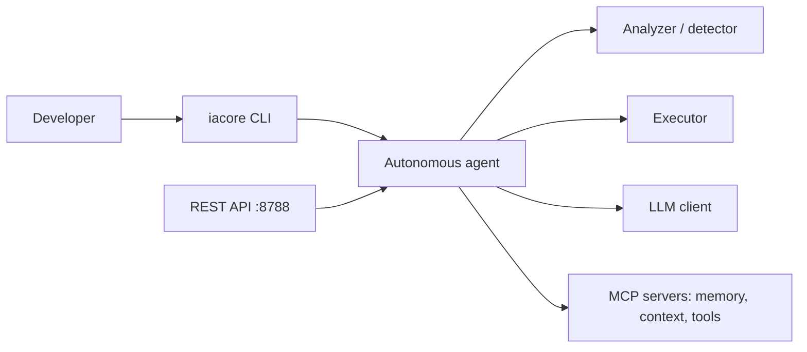

# 🤖 IA_Core — Autonomous AI agent layer for any project

[](https://jeturing.com)
[](https://jeturing.com)
[](LICENSE)

**IA_Core installs into any project and manages it intelligently: it deeply analyzes the project (frameworks, languages, dependencies, structure), auto-configures itself, deploys MCP servers (memory, context and tools), exposes a CLI and a REST API, and runs an autonomous agent in the background that observes and assists while you work.**

> 📍 **State discipline** — every capability in this README carries its state: **Built** (in `main`, with tests or evidence) · **In development** (on a branch) · **Designed** (specified, not built) · **Concept** (recorded idea). States are never mixed.

| At a glance | |
|---|---|
| **Form** | Python package (`iacore/`) + CLI (`iacore`, in `bin/`) + bundled skills |
| **State** | Persistent learning in its MCP memory server; credentials are prompted at install time and never live in this repo |
| **Interfaces** | CLI and REST API on port 8788; English |
| **Deployment** | One installer (`install.sh`) into the target project; no hosted service |

---

## 📋 Table of contents

- [🌐 Position in the ecosystem](#️-position-in-the-ecosystem)
- [🧩 Capabilities and state](#️-capabilities-and-state)
- [🏗️ Architecture](#️-architecture)
- [🗂️ Repository map](#️-repository-map)
- [🔒 Security model](#-security-model)
- [🖥️ Surfaces and API](#️-surfaces-and-api)
- [🚀 Installation and deployment](#-installation-and-deployment)
- [⚙️ Configuration](#️-configuration)
- [🩺 Troubleshooting](#-troubleshooting)
- [🗺️ Honest limits and roadmap](#️-honest-limits-and-roadmap)
- [📝 Changelog](#-changelog)
- [👥 Credits](#-credits)

## 🌐 Position in the ecosystem

Internal tooling of **Desarrollar** (Jeturing, build-what-is-missing): IA_Core is the autonomous agent layer the house installs into a project to analyze it and assist its development, instead of buying an external agent platform.

What it is **NOT**: it is not a hosted product and it is not the house's production AI core — it is an installable layer that lives inside the target project, with that project's own credentials and lifecycle.

## 🧩 Capabilities and state

- **Deep project analysis** — Built. `iacore/core/analyzer.py` and `iacore/core/detector.py`: detects 20+ project types (frameworks, languages, build tools, dependencies) and recommends agents per stack.
- **Autonomous agent** — Built. `iacore/agent/autonomous.py`: background monitoring of the project after installation, with pause/resume from the CLI.
- **MCP servers** — Built. `iacore/mcp/`: memory, context and tools servers (`memory_server.py`, `context_server.py`, `tools_server.py`); configuration template in `mcp.json`.
- **LLM client** — Built. `iacore/core/llm_client.py`: the agent's model access (an API key is recommended for full functionality; without one, functionality is limited with fallbacks).
- **Executor** — Built. `iacore/core/opencore_executor.py`: silent command execution layer, with dangerous commands blocked (see Security).
- **CLI** — Built. `iacore/cli/main.py` (binary in `bin/iacore`): `status`, `logs`, `pause`, `resume`, `config`, `analyze`, `version`, `uninstall`.
- **REST API** — Built. `iacore/api/server.py`: HTTP API on port 8788 for integrations.
- **Bundled skills** — Built. `skills/`: `project-analyzer`, `memory-manager`, `chrome-devtools` and `autonomous-executor`, plus the root `SKILL.md`.

## 🏗️ Architecture



## 🗂️ Repository map

```text
IA_Core/
├── iacore/
│   ├── core/               # Analyzer, detector, LLM client, executor
│   ├── agent/              # Autonomous agent
│   ├── mcp/                # MCP servers: memory, context, tools
│   ├── api/                # REST API server (port 8788)
│   ├── cli/                # CLI entry point
│   └── utils/              # Logging
├── bin/iacore              # Installed CLI binary
├── skills/                 # Bundled skills (analyzer, memory, devtools, executor)
├── install.sh              # Installer into a target project
├── AGENT_SPEC.md           # Agent specification (at root: referenced by verify.sh)
├── DEPLOYMENT.md           # Deployment guide (at root: referenced by verify.sh)
└── docs/                   # Documentation index — docs/README.md
```

The full documentation is indexed in [`docs/`](docs/README.md).

## 🔒 Security model

- Credentials are requested interactively during installation (or later with `iacore config`) and stored by the target installation — never in this repository.
- The executor blocks dangerous commands; the agent works inside the project it was installed into.
- Without an LLM API key the agent degrades to limited functionality with fallbacks instead of failing open into uncontrolled actions.

## 🖥️ Surfaces and API

- CLI: `iacore status | logs | pause | resume | config | analyze | version | uninstall`.
- REST API on port 8788 (`iacore/api/server.py`) for integrations with the installed agent.

## 🚀 Installation and deployment

### Requirements

- Python 3.9+.
- An LLM API key is recommended for full functionality (limited mode without one).

### Install

```bash
git clone https://github.com/jeturing/IA_Core.git
cd IA_Core
bash install.sh
```

The installer analyzes the target project, prompts for the credentials it needs, auto-configures workflows, deploys the MCP servers and starts the agent. See [`INSTALLATION_FEATURES.md`](INSTALLATION_FEATURES.md) and [`DEPLOYMENT.md`](DEPLOYMENT.md).

### Verification

```bash
bash verify.sh
iacore status
```

## ⚙️ Configuration

| Parameter | Where it lives | Notes |
|---|---|---|
| LLM API key | Target installation (prompted, or `iacore config`) | Never in this repo |
| MCP configuration | `mcp.json` and the generated project config | Auto-detected for backend/API projects; can be skipped |

## 🩺 Troubleshooting

### The agent runs with limited functionality

Cause: no LLM API key was configured at install time. Correction: run `iacore config` in the target project and add the key; full analysis and recommendations need it.

### The analysis does not reflect a big refactor

Cause: the project changed shape after the initial analysis. Correction: `iacore analyze` re-runs the deep analysis and refreshes the recommended agents.

## 🗺️ Honest limits and roadmap

- The historical README advertised a one-line install URL with an unsubstituted `YOUR_USERNAME` placeholder: that URL never worked as printed. The supported path is cloning this repo and running `install.sh` (above).
- Several root documents (`AGENT_SPEC.md`, `DEPLOYMENT.md`) stay at the root on purpose: `verify.sh` references them by that path; they are indexed from `docs/README.md` instead of moved.
- The repository also carries the helper scripts used to create and push the house's GitHub repos (`create_and_push.sh` and companions); they are tooling of this repo's own history, documented in `GITHUB_SETUP.md` and `EXECUTE_PUSH.md`.

## 📝 Changelog

### 2026-01-27 — GitHub repo creation scripts (`0e6116c`)

- Scripts to create and push repositories to GitHub, on top of the agent layer (analysis, MCP servers, CLI and API) already in `main`.

## 👥 Credits

**Jeturing Inc.** — internal tooling (Desarrollar). Contributions: see [`CONTRIBUTING.md`](CONTRIBUTING.md). MIT license (see `LICENSE`).
